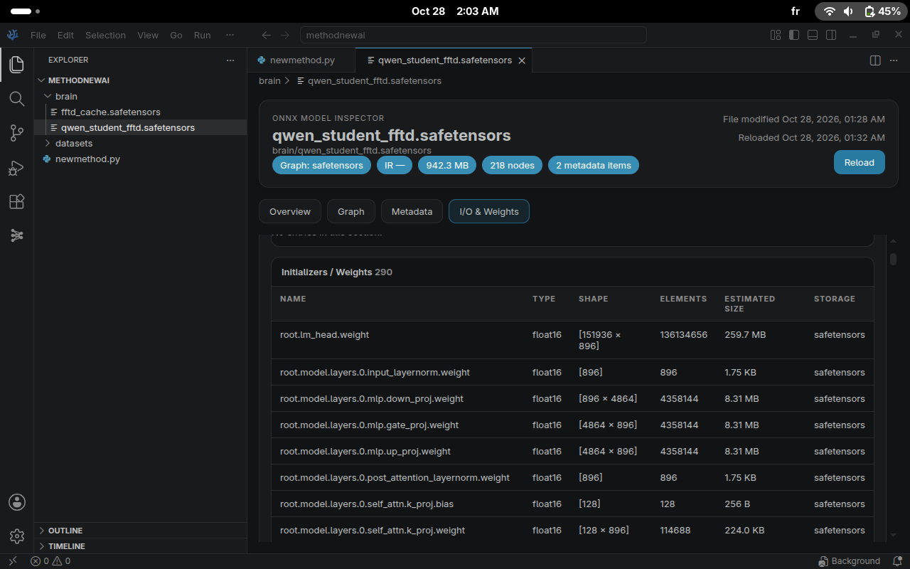

# FFTD: Friend and Friend Teacher Distillation

## 🌟 Introduction
Traditional knowledge distillation relies on a strict Teacher-Student paradigm, where a smaller model blindly mimics a larger one. We introduce **FFTD (Friend and Friend Teacher Distillation)**, a novel approach where the student learns from two sources simultaneously: a peer (Friend) and the peer's teacher (Friend's Teacher).

## 🧠 The Concept
Imagine you are a student. Instead of only listening to a strict professor, you study with a **smart classmate (Friend)** to understand the basics, and then you consult **your classmate's teacher** to gain deep insights. 
By combining both, you build a stronger, independent understanding without blindly copying the teacher.

## 📐 The Mathematical Function
Our approach is governed by a custom loss function that balances learning with independence:

**L = α · KL(S_new || S_friend) + (1-α) · KL(S_new || T_friend) - β · Sim(S_new, S_friend)**

*   **α · KL (Friend):** Learns the language and style from the peer.
*   **(1-α) · KL (Teacher):** Absorbs deep knowledge from the expert.
*   **- β · Sim (Independence):** A negative similarity penalty that prevents the student from becoming a blind copy, forcing it to develop a unique identity.

## 🏗️ Architectural Integrity
A key feature of FFTD is that it preserves the **exact architecture** of the base model. In our Proof of Concept (PoC), we instantiated a completely new model using `AutoModelForCausalLM.from_config(config)`. 
**We did NOT load the original pre-trained weights.** The model's weights were initialized from scratch and trained exclusively using FFTD's distilled knowledge. This proves that FFTD can create a fully functional, structurally identical model without violating copyrights or stealing weights.

## ⚙️ Hardware Flexibility & Dynamic Precision
The provided code and the screenshot demonstrate the Proof of Concept (PoC) running on a **CPU without CUDA**, utilizing **4-bit quantization (`int4`)** to minimize RAM consumption and fit the model into the available memory (using Swap). 

However, the architecture is **highly flexible**. You are not locked into `int4`. You can easily control the tensor precision based on your hardware capabilities:
*   **For High-End GPUs (CUDA):** The script automatically detects CUDA and uses `float16` (FP16) for maximum speed and stability.
*   **For CPUs (Low RAM):** The script falls back to `int4` via `bitsandbytes` or `float32` depending on your setup.
*   **Manual Control:** You can modify the `torch_dtype` and `BitsAndBytesConfig` inside the code to use `bfloat16`, `float32`, or any quantization level you prefer.

**Proof of Concept Screenshot:**
*(This is a screenshot from VS Code showing the successful extraction of logits using `float16` after loading the models in `int4` on a CPU).*



## 🚀 Usage
1. Install requirements:
   ```bash
   pip install torch transformers safetensors bitsandbytes accelerate```
2. Run the FFTD pipeline :
   ```bash
   python newmethod.py```
3. Custom Models / Dataset:
You can override the default models and dataset using environment variables:
```bash
export FFTD_FRIEND_MODEL="AnotherOrg/Model-A"
export FFTD_TEACHER_MODEL="AnotherOrg/Model-B"
export FFTD_DATASET="datasets/sample.txt"
python newmethod.py
```
## ⚠️ CRITICAL LEGAL AND ETHICAL WARNING
READ THIS BEFORE USING THIS CODE.

By using, cloning, or modifying this code, you AGREE to the following strict terms:

1. NO UNAUTHORIZED ARCHITECTURAL REPLICATION
It is STRICTLY PROHIBITED to use this code to replicate the architecture of any proprietary or commercial model without explicit written permission from its owners. Building a "third student" with the exact architecture of a company's model without a license is a violation of Intellectual Property rights.

2. NO MALICIOUS OR ATTACK MODELS
It is STRICTLY PROHIBITED to use FFTD to build offensive, malicious, or harmful AI models.

3. LIMITATION OF LIABILITY
The author (Mouad Tarif) holds NO LIABILITY for any misuse, copyright infringement, or illegal activities committed by users employing this code. You (the User) are solely responsible for your actions.

Author: Mouad Tarif
Acknowledgment: Inspired by the concept of TAID (Sakana AI), but evolved into a completely different mathematical and structural approach.
